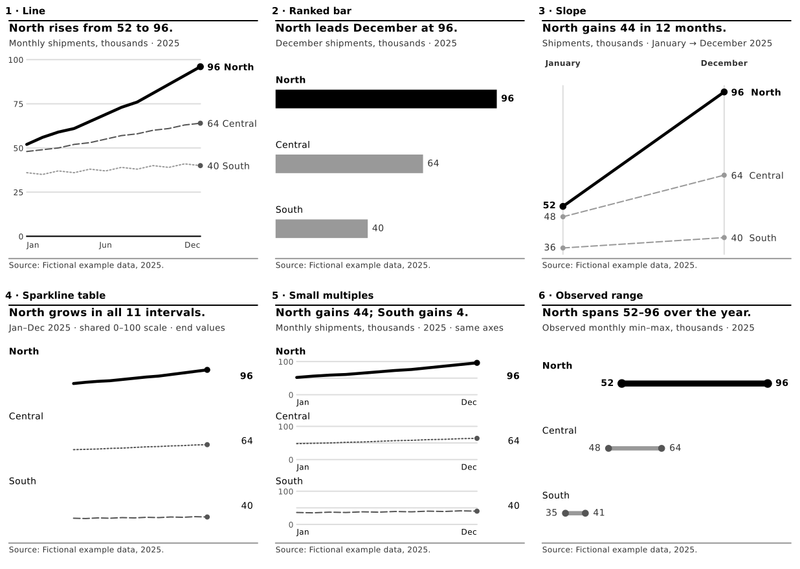

# kindle-reading-kit

A portable, MIT-licensed design skill for grayscale e-reader charts. The skill
id is `kindle-reading-kit` (also recognized as `eink-chart-design`). **Editorial
Soft** is the default: thin gray context, a quiet editorial top rule, estimation
guides, and one black focal mark with bold direct labels. The default plus four
alternatives stay selectable. This repo is for charts and short chart samples.
A full book or report conversion belongs to kindle-edition.

Trigger phrases include "make this chart readable on Kindle", "e-ink friendly
chart", "grayscale chart for e-reader", and "make this table readable on Kindle".
No personal details, network calls, accounts, proprietary fonts, repository
setup, or email delivery are required.
Capability tiers (full shell, offline Python without pip or network, and no
code) are in `SKILL.md`.



*Editorial Soft, the default style, on fictional example data. Vector preview of the 1236 px grayscale chart PNGs the kit renders for a 6.8-inch Paperwhite.*

## Quick start
Python 3.10+ recommended. Paths below are relative to this folder. The scripts
themselves resolve their files from `__file__`, so they also run from another
working directory when you pass absolute paths.

```sh
python -m pip install -r requirements.txt
python -m pip install -r requirements-optional.txt
python examples/render_charts.py --out output/charts
python examples/render_charts.py --style pattern-texture --out output/pattern
python scripts/test_kit.py
python tests/test_styles.py
python tests/test_portability.py
python tests/test_tables.py
python examples/build_sample.py --out output/sample
python scripts/check_epub.py output/sample/E-ink-Chart-Default-Sample.epub
python scripts/preview_kindle.py output/sample/E-ink-Chart-Default-Sample.epub output/preview
```

`requirements.txt` is Matplotlib and Pillow, enough to draw charts.
`requirements-optional.txt` adds EPUB packaging (`bs4`, `lxml`) and preview
(`weasyprint`, `pypdf`). Preview also needs Poppler's `pdftoppm` on `PATH`
(Debian/Ubuntu package `poppler-utils`) and WeasyPrint's system libraries.
If those are missing, preview exits non-zero with `preview skipped:` and does
not claim success. A skip is not a pass.

The preview helper writes a `.kindle-preview` marker in each folder it creates.
`--force` replaces only a non-empty folder that already has that marker. Any
other non-empty folder is refused and left untouched. It refuses dangerous
paths even with `--force`: the filesystem root, your home directory, the
current directory, this repo, `/tmp` itself, other broad system directories,
and symlinks. Inspect every generated `sheet_*.png`. Page footers continue
across spine items. See `RUNBOOK.md`.

## Send to Kindle

The kit works best when you add your agent's email address to your Amazon
Approved Personal Document E-mail List. The agent can then email the EPUB to
your Send to Kindle address. Without that, you move the file over by hand.
The agent sends only when you ask.

## Files
- `SKILL.md`: platform-neutral recipe (tiers, numeric table, forms, tables, styles).
  Copy this folder into a skill loader or supply it with the prompt.
- `RUNBOOK.md`: repo install, paths, packaging, preview safety, device notes.
- `evals/prompts.md`: nine behavior prompts and the expected agent response.
- `scripts/kindle_charts.py`: core bars, lines, slopes, ranges, callouts, palette
  validator, downscaling, text fallback and figure HTML. Chart functions take
  an optional `style=` argument.
- `scripts/eink_style.py`: five named style contexts, small multiples, sparklines.
- `scripts/kindle_epub.py`: EPUB3/NCX packaging for a short chart sample.
- `scripts/kindle_tables.py`: the table ladder. Picks prose, a ranked list, a
  small text table, or record cards so values reflow at any font size, and lints
  tables in an EPUB.
- `scripts/epub_paths.py`: OPF path from `META-INF/container.xml`.
- `scripts/check_epub.py`, `preview_kindle.py`: structural checks and simulation.
- `examples/data.json`: **fictional** 2025 regional shipments in thousands;
  identical data across all forms and options. `render_charts.py` is the plotting
  example; `matplotlib_only.py` is a self-contained Matplotlib script;
  `build_sample.py` builds a short EPUB and a six-chart contact sheet.
  `table_ladder.py` builds a before and after EPUB from one fictional table.
- `assets/preview-editorial-soft.svg`: README preview rendered from the fictional example data.
- `tests/test_styles.py`: all five styles × six forms, input checks, restoration.
- `tests/test_portability.py`: preview path guards, container.xml, missing optional
  dependencies, and runs from a directory other than the repo root.
- `tests/test_tables.py`: table ladder choices, caps, focal rows, EPUB table lint,
  and a larger `--font-scale` preview.

## Design contract
Reference screen for the asset grid: **11th-generation 6.8-inch Paperwhite,
300 ppi, 1236 × 1648**, nominal 16 gray levels. The 2024 12th-generation
Paperwhite is a 7-inch 300 ppi panel (reviewers report 1264 × 1680). Kindle
Colorsoft is a 7-inch color panel; Amazon lists 300 ppi in black and white,
150 ppi in color, and 16 gray levels, and does not publish a pixel grid here.
Confirm the device. Assets stay 1236 px wide unless you ask for another size.
Strokes are at least 1.5 pt at 4.12 inches wide. Small raster text is
intentional (9.5 pt minimum); native text stays reflowable.
All styles preserve the bold black focal element. `style()` assigns module
globals for the duration and restores them. Pass `style=` for one call. A second
thread raises `RuntimeError`. Return dictionaries retain source values and
support native-text alternatives. `check_png` validates pixels, not font sizes,
collisions, meaning, or actual hardware performance.

Data are fictional, not an estimate or business claim. Sample observed ranges
are min–max, not confidence intervals. Titles are illustrative action headlines.
See `SKILL.md` for chart selection, numeric guardrails and a review checklist.

## Provenance and scope
This recipe draws on Tufte's restraint/data-ink principles, consulting-style
answer-first storytelling and action headlines, and an editorial top-rule
visual grammar. These are design inspirations, not endorsements or copied book
content. The portable chart/EPUB helpers extend the local Kindle-edition toolkit;
style and compact-chart extensions are included here. Dependencies retain their
own licenses; no external typeface is bundled (Matplotlib resolves DejaVu).

A simulated preview cannot guarantee physical e-ink legibility or Amazon's
conversion. Recheck on target hardware after conversion. This project only
creates local files; sending and publishing are separate, explicitly authorized
steps.

License: MIT; see `LICENSE`.
